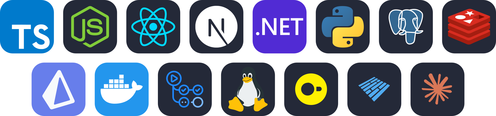

  

  

 

## 🚀 What I'm building

- **[Cipiti.ai](https://cipiti.ai)** — a multi-tenant live support chat platform with built-in AI assistance · *with [Art-of-Technology](https://github.com/Art-of-Technology)*
- **Internal AI tooling** — agents that read codebases, answer questions and turn findings into clean, actionable issues
- **Analytics & risk** — DuckDB/Parquet pipelines, fraud detection and automated reporting

## 🧰 Stack

  

## 💡 What I care about

- Turning messy operational problems into simple, automated systems
- AI as a teammate — agents that read, reason and open the PR
- Data you can act on, not just dashboards

## 📊 GitHub stats

  

 

  <picture>
    <source media="(prefers-color-scheme: dark)" srcset="https://raw.githubusercontent.com/mertv-dev/mertv-dev/output/github-snake-dark.svg" />
    
  </picture>

  <i>Always up for a chat about AI tooling, real-time systems and data.</i>

  

